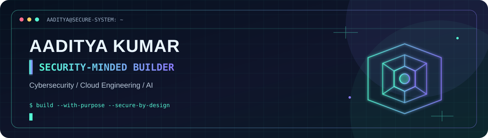

<p align="center">
  
</p>

<a href="https://github.com/AadityaZenith">
  
</a>

<p align="center">
  <a href="https://github.com/AadityaZenith"></a>
  <a href="mailto:your.email@example.com"></a>
</p>

<p align="center">
  
</p>

<svg width="100%" height="220" viewBox="0 0 1200 220" xmlns="http://www.w3.org/2000/svg" role="img" aria-label="Aaditya Zenith hero animation">
  <defs>
    <linearGradient id="bg" x1="0%" y1="0%" x2="100%" y2="100%">
      <stop offset="0%" stop-color="#07111D"/>
      <stop offset="49%" stop-color="#0B1F2A"/>
      <stop offset="100%" stop-color="#10192B"/>
    </linearGradient>
    <radialGradient id="pulseGlow" cx="50%" cy="50%" r="50%">
      <stop offset="0%" stop-color="#7CF7D6" stop-opacity="0.9"/>
      <stop offset="50%" stop-color="#7C8CFF" stop-opacity="0.45"/>
      <stop offset="100%" stop-color="#0B1220" stop-opacity="0"/>
    </radialGradient>
  </defs>
  <rect x="0" y="0" width="1200" height="220" rx="22" fill="url(#bg)"/>
  <circle cx="180" cy="110" r="120" fill="url(#pulseGlow)" opacity="0.8">
    <animate attributeName="cx" values="180;1020;180" dur="12s" repeatCount="indefinite"/>
    <animate attributeName="cy" values="110;95;110" dur="9s" repeatCount="indefinite"/>
    <animate attributeName="opacity" values="0.35;0.9;0.35" dur="7s" repeatCount="indefinite"/>
  </circle>
  <circle cx="910" cy="60" r="92" fill="url(#pulseGlow)" opacity="0.5">
    <animate attributeName="r" values="50;110;50" dur="8s" repeatCount="indefinite"/>
    <animate attributeName="opacity" values="0.2;0.7;0.2" dur="6s" repeatCount="indefinite"/>
  </circle>
  <path d="M 0 160 C 200 110, 360 220, 540 170 S 860 90, 1200 150 L 1200 220 L 0 220 Z" fill="#112333" opacity="0.65"/>
  <g fill="#EAFBFF" font-family="Segoe UI, sans-serif" font-weight="700">
    <text x="60" y="95" font-size="34" letter-spacing="1.5">AADITYA ZENITH</text>
    <text x="60" y="130" font-size="20" fill="#7CF7D6" font-weight="600">Cybersecurity • Cloud • AI • Builder</text>
  </g>
  <rect x="60" y="150" width="270" height="10" rx="5" fill="#7CF7D6" opacity="0.75">
    <animate attributeName="width" values="60;270;60" dur="4s" repeatCount="indefinite"/>
  </rect>
</svg>

```text
┌──(aaditya㉿zenith)-[~/mission]
└─$ whoami
Aaditya Kumar
Cybersecurity student, cloud engineer, AI builder, and hands-on problem solver.
```

I'm a developer and technical learner focused on building practical systems at the intersection of security, cloud, and AI. I enjoy turning complex ideas into working solutions and sharing what I learn with the community.

```yaml
currently:
  focus:
    - Cybersecurity & security automation
    - Microsoft Azure & cloud-native architecture
    - AI-powered tools & full-stack apps
    - Open-source learning and community
  approach: "Learn deeply. Build practically. Share openly."
  base: India
```

## `toolkit --list`

**Languages & development**


**Cloud, security & tooling**


<p align="center">
  
  
  
  
</p>

## `activity.stream`

<p align="center">
  <a href="https://github.com/AadityaZenith">
    
  </a>
  <a href="https://github.com/AadityaZenith">
    
  </a>
</p>

<p align="center">
  
</p>

<p align="center">
  
</p>

<sub>Stats and charts are rendered by third-party services and may occasionally be delayed or unavailable.</sub>

## `connect --secure`

<p align="center">
  <a href="https://github.com/AadityaZenith"></a>
  <a href="https://www.linkedin.com"></a>
</p>

> I’m interested in practical work at the intersection of security, cloud, and AI.


<sub>BUILD • BREAK (ETHICALLY) • LEARN • REPEAT</sub>
