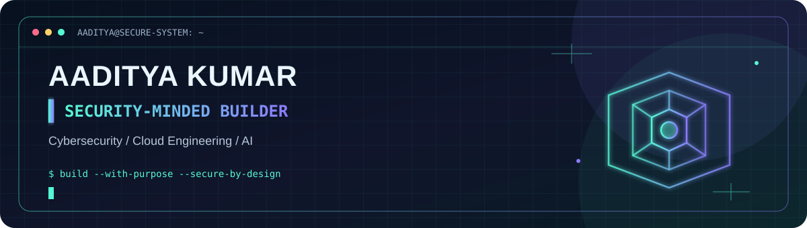

<br>

<a href="https://github.com/24100030001uset-max">

</a>

<p>
<a href="https://github.com/24100030001uset-max?tab=repositories"></a>
<a href="https://github.com/24100030001uset-max"></a>
</p>

------------------------------------------------------------------------

## `whoami`

```text
┌──(aaditya㉿builder)-[~/mission]
└─$ cat profile.json
```

> I'm **Aaditya Kumar** --- a cybersecurity student, developer, and technical trainer interested in turning complex technology into practical, useful solutions.

I work across **cybersecurity, cloud engineering, AI-powered applications, and full-stack development**. I also enjoy teaching technical concepts through hands-on labs, real-world scenarios, and build-first learning.

```yaml
currently:
  focus:
    - Cybersecurity & security automation
    - Microsoft Azure and cloud-native services
    - AI-powered tools and full-stack applications
    - Technical training and developer communities
  approach: "Learn deeply. Build practically. Share openly."
  base: India
```

## `mission.log` --- What I'm building

<table>
<tr>
<td width="50%" valign="top">

### 🛡️ Pratayak AI

**Deepfake detection**

An AI-focused concept for analyzing suspicious video and voice content to help identify potential synthetic media.

`AI/ML` `Media Analysis` `Trust & Safety`

</td>
<td width="50%" valign="top">

### 👁️ Smart Vision Glasses

**Assistive technology**

A concept for voice-assisted object recognition and text-to-speech feedback to support visually impaired users.

`Computer Vision` `TTS` `Embedded Systems`

</td>
</tr>
<tr>
<td width="50%" valign="top">

### 🇮🇳 Indian Standards Recommendation

**AI for procurement discovery**

A recommendation-engine concept to help map procurement requirements to applicable Indian Standards.

`Python` `FastAPI` `React` `LLM Integration`

</td>
<td width="50%" valign="top">

### ☁️ Cloud Labs

**Learning by deploying**

Hands-on experiments with Azure storage, integration, messaging, API management, secrets, monitoring, and analytics.

`Microsoft Azure` `APIs` `Cloud Security`

</td>
</tr>
</table>

<sub>Project descriptions reflect concepts and work areas; check each repository for implementation status and current details.</sub>

## `toolkit --list`

**Languages & development**


**Cloud, security & tooling**


<p align="center">


</p>

## `field_notes` --- Beyond the code

- **Technical training:** explaining cybersecurity, cloud, and development concepts through guided practicals.
- **Community:** helping build developer communities and student-led technical activities.
- **Security mindset:** understanding how systems fail, how to test them responsibly, and how to improve them.
- **Builder mindset:** turning ideas into prototypes, then improving them through feedback.

## `activity.stream`

<a href="https://github.com/24100030001uset-max">

</a>
<a href="https://github.com/24100030001uset-max">

</a>

<br>


<br>


<sub>Stats are rendered by third-party services and may occasionally be delayed or unavailable.</sub>

## `connect --secure`

<a href="https://github.com/24100030001uset-max"></a>
<a href="https://www.linkedin.com/"></a>

> **Have a meaningful idea?** I'm interested in practical projects at the intersection of security, cloud, and AI.


<sub>BUILD • BREAK (ETHICALLY) • LEARN • REPEAT</sub>
